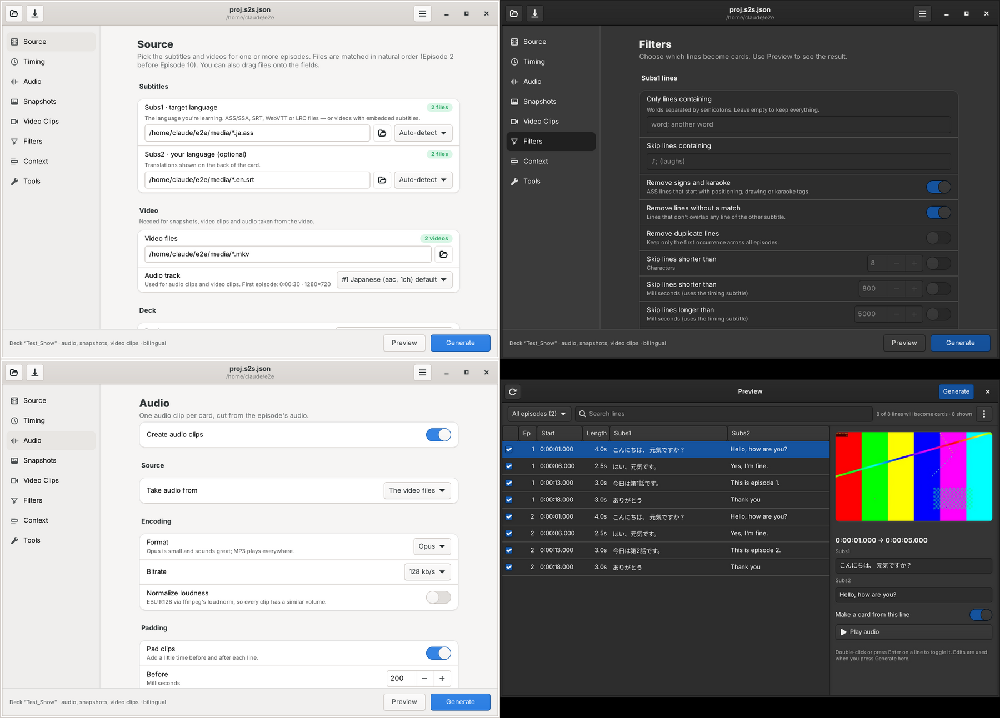

# subs2srs (Rust/GTK4)

Create [Anki](https://apps.ankiweb.net/) flashcards from TV shows and movies
with subtitles, for language learning. Each card gets the line in the language
you're learning, an optional translation, an audio clip, a snapshot and
optionally a short video clip.

A native Linux port of [subs2srs](https://github.com/Ajatt-Tools/subs2srs),
rewritten in Rust with a modern GTK4 interface.



- **Follows your GTK theme**: it doesn't force Adwaita. Light, dark or
  “Follow system”. System mode follows the desktop's colour-scheme setting
  (GNOME, KDE and anything with xdg-desktop-portal) and updates live. If your
  theme ships its dark variant as a separate theme (`Foo-dark`), subs2srs
  switches to it.
- **Same processing as the original**: line matching, sentence joining, time
  shifts, filters, context lines, and `${token}` naming formats compatible
  with the original.
- **Faster**: audio, snapshots and video clips are made in parallel.
- **More inputs**: ASS/SSA, SRT, WebVTT and LRC, plus text subtitle tracks
  embedded in MKV/MP4/WebM, which are extracted with ffmpeg (no mkvextract
  needed).
- **Preview**: see every matched line, switch lines on or off, fix typos,
  check the snapshot and listen to the clip before you generate.
- **Anki-ready output**: the `.tsv` file gets `#separator`, `#html` and
  `#tags column` headers, so Anki 2.1.55+ sets up the import for you.
- **Headless CLI** (`subs2srs-cli`) for scripts and batch jobs, using the same
  project files.

## Requirements

- GTK ≥ 4.12
- ffmpeg and ffprobe in `$PATH`, built with libopus, libmp3lame and libx264
  (on Gentoo: `media-video/ffmpeg` with `USE="mp3 opus x264"`)
- librsvg (for the SVG icons; almost every desktop already has it)
- Rust ≥ 1.80 to build
- Optional: `mpv` or `ffplay` to play clips in the preview window

## Build and install

```sh
git clone https://github.com/tomjfinch/subs2srs-linux.git
cd subs2srs-linux
make            # cargo build --release
sudo make install            # to /usr/local
# or: make install PREFIX=$HOME/.local
```

Gentoo users can also use the live ebuild in
`packaging/gentoo/media-video/subs2srs/` (copy it into a local overlay).

Run without installing: `cargo run --release`.

## Using it

1. **Source**: choose Subs1 (the language you're learning), optionally Subs2
   (your language), and the videos. A field takes a file, a folder or a glob
   like `~/anime/Show/*.ass`; selecting several files in the file chooser or
   dropping them onto the field builds the pattern for you. Episodes are paired
   in natural order (2 before 10). If the subtitles are inside the video, point
   Subs1/Subs2 at the videos and pick the track.
2. Enter a **deck name** and an **output folder**.
3. Adjust **Audio**, **Snapshots**, **Video Clips**, **Filters** and
   **Context** as needed. **Preview** shows exactly which lines become cards.
4. Press **Generate**. You get `<deck>.tsv` and a `<deck>.media` folder.
   Copy the media files into Anki's `collection.media` folder, then import the
   `.tsv` (File → Import).

Media files that already exist are kept, so you can cancel and resume, or
add new episodes without redoing the old ones.

Save your settings as a project (`.s2s.json`) with Ctrl+S. Menu → “Use
Current Settings as Default” makes them the starting point for new projects.

### Keyboard shortcuts

| Shortcut | Action |
|---|---|
| Ctrl+O / Ctrl+S / Ctrl+Shift+S | Open / save / save project as |
| Ctrl+N | New project |
| Ctrl+P | Preview |
| Ctrl+Enter | Generate |
| Ctrl+, | Preferences |

### Card fields

By default each line of the `.tsv` is:

`Tag · Sequence marker · Audio · Snapshot · Video · Subs1 · Subs2` followed by
any context lines. Disabled media columns are left out. All file names and
fields are configurable in Preferences with tokens such as `${deck_name}`,
`${0:episode_num}`, `${s_total_hour}`, `${subs1_line}`. `${3:…}` pads to three
digits, `${0:…}` pads to the widest value needed.

### Tools

- **Dueling subtitles**: `.ass` files that show both languages at once, with
  your choice of fonts, colours and positions, plus an optional plain-text
  transcript.
- **Extract audio**: whole episodes or fixed-length chunks as MP3/Opus/AAC
  for listening practice, optionally with the subtitles as lyrics tags.

### Command line

```sh
subs2srs project.s2s.json                     # open a project in the GUI
subs2srs-cli generate project.s2s.json        # run headless
subs2srs-cli preview  project.s2s.json        # list matched lines
subs2srs-cli dueling  project.s2s.json
subs2srs-cli extract-audio '~/show/*.mkv' ~/out Show 300
subs2srs-cli probe episode.mkv                # list audio/subtitle tracks
subs2srs-cli defaults > new.s2s.json          # a project file to edit
```

## Files

| Path | What |
|---|---|
| `~/.config/subs2srs/preferences.json` | Theme, naming formats, behaviour |
| `~/.config/subs2srs/default-project.s2s.json` | Defaults for new projects |
| `~/.config/subs2srs/dueling.json`, `extract-audio.json` | Tool settings |

Environment variables `SUBS2SRS_FFMPEG` and `SUBS2SRS_FFPROBE` override the
ffmpeg/ffprobe binaries.

## Differences from the original

- Lines are only dropped as “styled” when they start with positioning, drawing
  or karaoke tags (`\pos`, `\move`, `\p1`, `\k`…). The original dropped every
  line starting with `{`, which also removed dialogue that just starts in
  italics.
- Sequence numbers are identical in the `.tsv` and in media file names, also
  when context lines are used.
- The last line of an episode can be used as trailing context.
- Snapshot/video crop values are in source-video pixels, applied before
  scaling. Height 0 keeps the aspect ratio (default 480 px wide).
- Video clips default to MP4 (H.264/AAC). WebM (VP9/Opus) and the original
  AVI (MPEG-4/MP3) are available.
- Loudness normalisation uses ffmpeg's `loudnorm` (EBU R128) instead of
  mp3gain, and works for every audio format.
- Audio tags are written by ffmpeg, so TagLib isn't needed.
- Not ported: VobSub/PGS (bitmap) subtitles and Transcriber (`.trs`) files.
  The original's project files aren't compatible.

## Project layout

```
crates/core/   processing library (no GTK): parsers, matching, naming, ffmpeg, tools
  src/bin/cli.rs   subs2srs-cli
src/           GTK4 application
data/          desktop file, metainfo, icons
```

`cargo test --workspace` runs the unit tests for parsing, matching, filters
and naming.

## Credits

- Christopher Brochtrup: original subs2srs
- erjiang: Linux/Mono port
- nihil-admirari: updated dependencies
- fkzys and contributors: GTK4/.NET rewrite (Ajatt-Tools/subs2srs)

## License

GPL-3.0-or-later, like the original. See [LICENSE](LICENSE).
